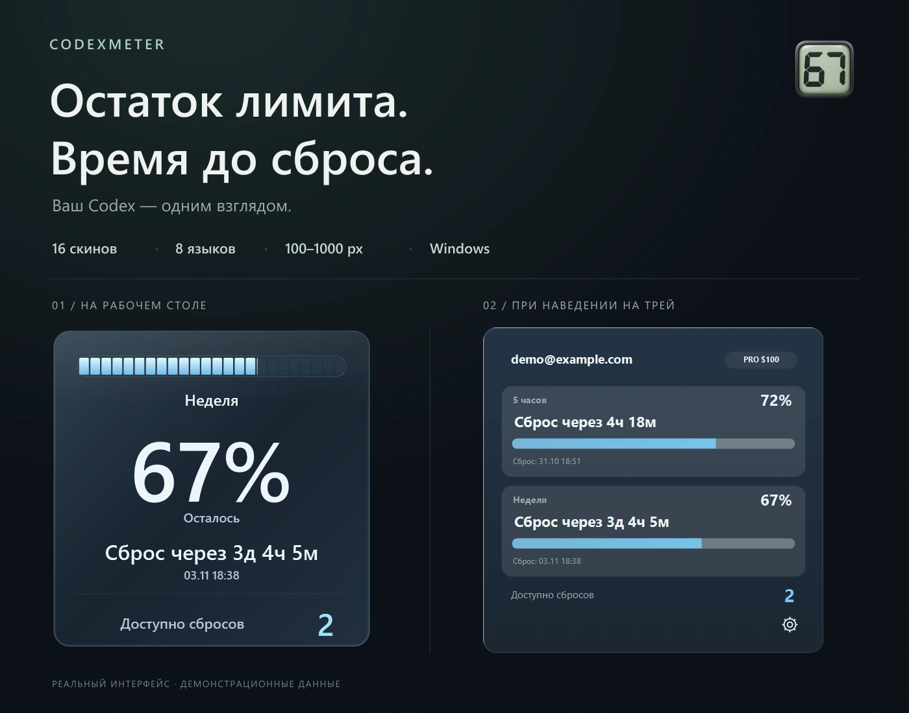
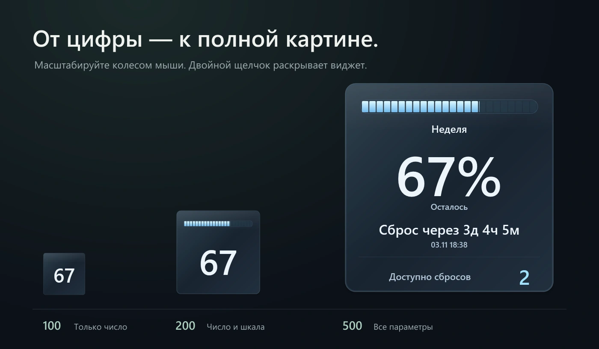
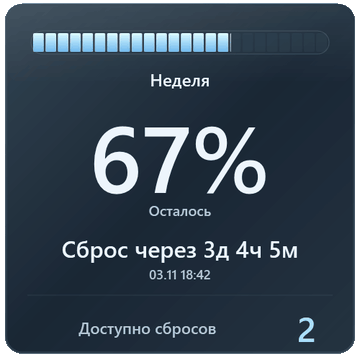
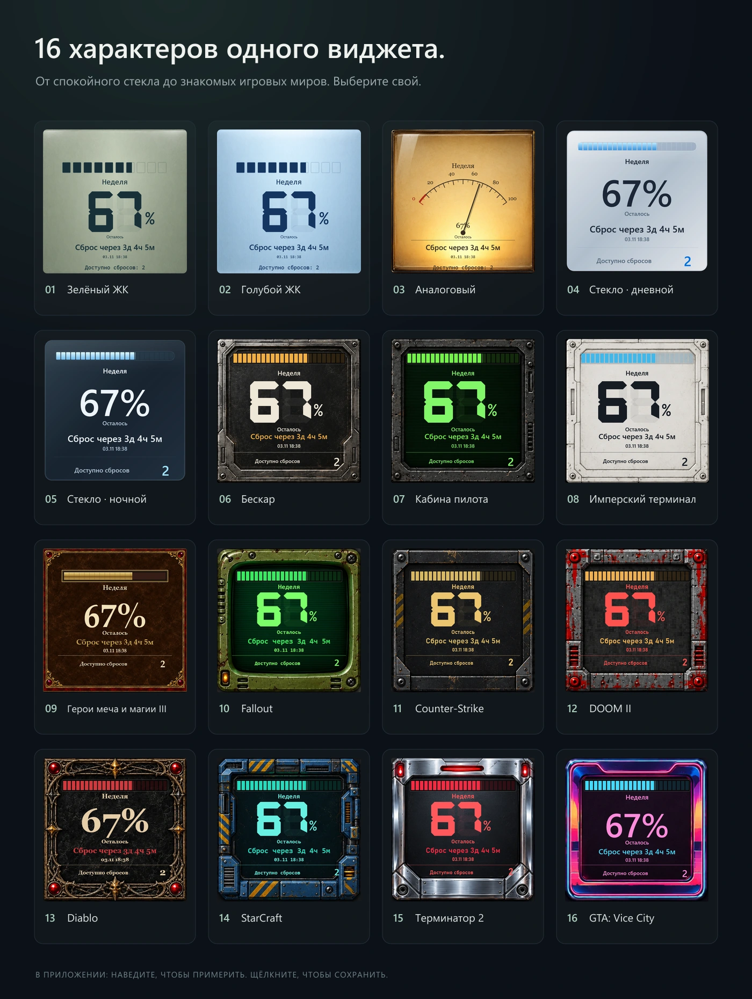

<div align="center">

# CodexMeter

**Your Codex limits, on your desktop and in your menu bar.**  
Remaining usage, time until reset, and available resets. At a glance.

[**↓ Download for Windows**](https://github.com/AlexDM777/codex-meter/releases/latest) &nbsp; · &nbsp; [**↓ Download for Mac**](https://github.com/AlexDM777/codex-meter/releases/latest/download/CodexMeter-macOS-universal.zip) &nbsp; · &nbsp; [Explore skins](#make-it-yours) &nbsp; · &nbsp; [Get started](#get-started)

Windows 10/11 · macOS 13+ · 16 skins · 8 languages

</div>



| What matters first | Your own look | Updates itself |
| :--- | :--- | :--- |
| Large remaining percentages and reset countdowns. Hover over the tray icon for details. | 16 skins, live previews, and custom themes. From glass to game-inspired worlds. | Updates through GitHub. Settings, sign-in and custom skins are preserved. |

## As small as you need

Keep a compact indicator on your desktop. Double-click to expand it and inspect the details. Scroll to resize from 100 to 1000 pixels.



## Numbers that move smoothly

Percentages change with a subtle transition. Countdown digits roll as the remaining time changes. Animations respect your system motion preferences.

<p align="center">
  
</p>

## Make it yours

Choose day or night glass, a classic LCD, an analog display, or a skin inspired by a favorite game or movie. Hover over a thumbnail to preview it; click to keep it. Use a new skin on every launch, or [create your own](SkinGuide.md).



<sub>The showcase images show the Windows interface with demonstration values. Countdown changes in the animation are accelerated. The Mac app uses the same skin library with its own native shell.</sub>

## Create a custom skin with Codex

**Add your own theme without changing application code.** Describe the look you want: dark wood and brass, a spaceship console, or a quiet light interface. The MD guide explains the skin format and the areas reserved for live data.

### 1. Get the guide

[**Open SkinGuide.md →**](SkinGuide.md) · [Download the MD file](https://raw.githubusercontent.com/AlexDM777/codex-meter/main/SkinGuide.md)

You can also copy it from the app: **Settings → Custom skins → Copy MD instructions**.

### 2. Ask Codex to create a theme

Attach `SkinGuide.md` to your Codex chat, or paste its contents, then describe your preferred style. For example:

> Create a CodexMeter skin following the attached MD guide. Use dark wood, a thin brass frame, and warm light digits. Provide skin.json and background.webp together in one folder.

The background is decoration only. CodexMeter draws the numbers, countdowns and progress bars so they continue to show live data.

### 3. Import the skin

Keep `skin.json` and `background.webp` in the same folder. Open **Settings → Custom skins → Import skin** and select **skin.json**.

Your theme appears in the gallery with its own number. It applies to the desktop widget, compact indicator and hover card; its palette also styles the tray indicator. Custom themes are preserved during updates and included in random skin selection.

<details>
<summary>Manual installation and compatibility</summary>

Use **Custom skins → Open skins folder** to open the library, put your theme in a separate folder, then click **Reload skins**.

- Windows: `%LOCALAPPDATA%\CodexMeter\UserSkins`
- Mac: `~/Library/Application Support/CodexMeter/UserSkins`

Existing packages using `background.png` are also accepted. See [SkinGuide.md](SkinGuide.md) for the JSON schema and image requirements.

</details>

## Get started

1. Install the official **Codex** app or CLI and launch it at least once.
2. [Download CodexMeter](https://github.com/AlexDM777/codex-meter/releases/latest). On Windows, choose **Setup.exe** or **Portable.zip**. On Mac, choose **macOS-universal.dmg** or **macOS-universal.zip**.
3. Open widget settings and select **Sign in to ChatGPT**. Complete sign-in in your browser.

The widget uses a separate account profile. No account credentials are included in downloads. Windows requires Windows 10/11 x64 and .NET Framework 4.8. The Universal Mac app supports macOS 13+ on Apple Silicon and Intel. Codex itself is not bundled.

On first launch, CodexMeter uses your system language when supported, otherwise English. You can change it in settings; your choice is remembered. Supported languages: English, Russian, German, Italian, Spanish, Serbian, French and Portuguese.

## On a Mac

[**Download the Universal ZIP →**](https://github.com/AlexDM777/codex-meter/releases/latest/download/CodexMeter-macOS-universal.zip) · [DMG and other downloads](https://github.com/AlexDM777/codex-meter/releases/latest) · [Mac installation guide](macos/MACOS.md)

Open the DMG and drag **CodexMeter.app** into **Applications**, or extract the ZIP there. Remaining usage appears in the macOS menu bar. Hover for the quota card and right-click for the menu.

CodexMeter automatically detects Codex.app and common CLI installations. If needed, expand **Codex connection** in settings and click **Find Codex**. A custom location can be selected using **Choose Codex.app**; you can select the app itself or its CLI executable. Sign-in errors are displayed in settings, with an option to reopen the browser or copy the sign-in link while authorization is pending.

The Mac app uses AppKit and the system WebKit. Settings and custom themes are stored in `~/Library/Application Support/CodexMeter`.

The app has an ad-hoc integrity signature, without Apple Developer ID or notarization. macOS may restrict its first launch. See the [Mac guide](macos/MACOS.md) for signature details and build instructions. Native tests run on Apple Silicon and Intel. A personal account is still required to verify completed sign-in and live limits.

## Everyday controls

- **Right-click:** skins, size, opacity, screenshot, always on top and settings.
- **Scroll:** resize. **Double-click:** expand and restore the widget.
- **Tray / menu bar:** remaining usage on the indicator and details on hover.
- **Settings:** language, startup, random skins and the limit shown in compact mode.

<details>
<summary><strong>How updates work</strong></summary>

CodexMeter checks stable releases in this repository shortly after startup and every six hours. A new release adds an update notice and button to the hover card. Settings distinguish app updates from refreshing usage data.

Automatic updates are enabled by default and can be disabled. Downloads are checked with SHA-256; installation uses a backup and rollback before restarting. Settings, sign-in and custom skins are preserved. Windows may request administrator permission if the installation folder requires it.

Update requests go to GitHub Releases; Codex account credentials are not sent to GitHub. See [RELEASING.md](RELEASING.md) for release instructions.

</details>

<details>
<summary><strong>Build and test</strong></summary>

On Windows:

```powershell
powershell -ExecutionPolicy Bypass -File .\source\build.ps1
powershell -ExecutionPolicy Bypass -File .\release.ps1
.\CodexMeter.exe --self-test
.\CodexMeter.exe --custom-test
.\CodexMeter.exe --update-test
```

The build uses the .NET Framework compiler included with Windows. Packaging produces the portable ZIP, installer, update package and checksums in `dist`.

On a Mac:

```sh
bash macos/build.sh
build/macos/CodexMeter.app/Contents/MacOS/CodexMeter --self-test
build/macos/CodexMeter.app/Contents/MacOS/CodexMeter --rpc-test /absolute/path/to/codex
```

The RPC test uses a temporary account profile to verify initialization, browser sign-in URL creation, cancellation and reconnect with the real Codex CLI. It does not use personal credentials. See [macos/MACOS.md](macos/MACOS.md) for requirements.

</details>

## Credits

Skins are inspired by familiar game and movie interfaces; CodexMeter is not affiliated with their rights holders. Third-party libraries and notices are listed in [ThirdParty.txt](ThirdParty.txt). The source is public; a separate project license has not yet been selected.
