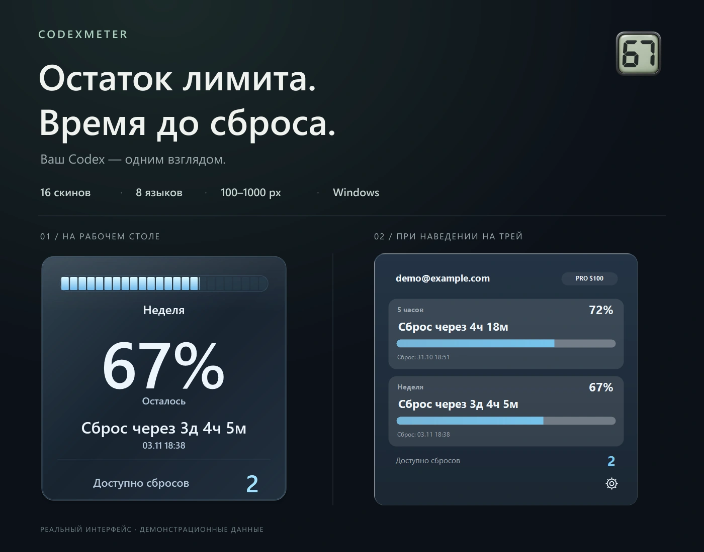
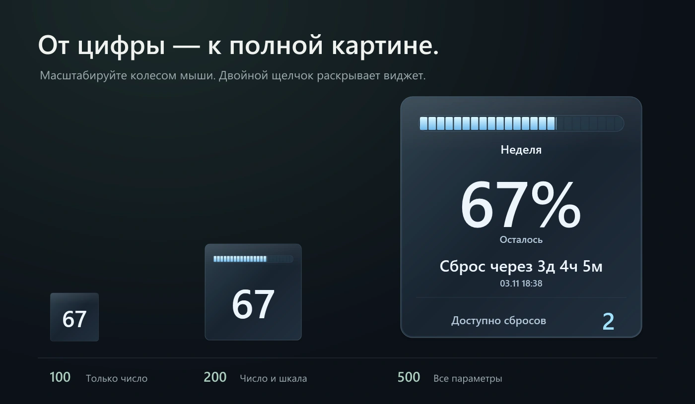
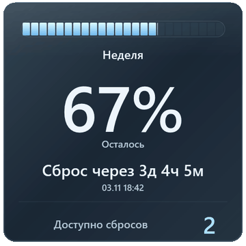
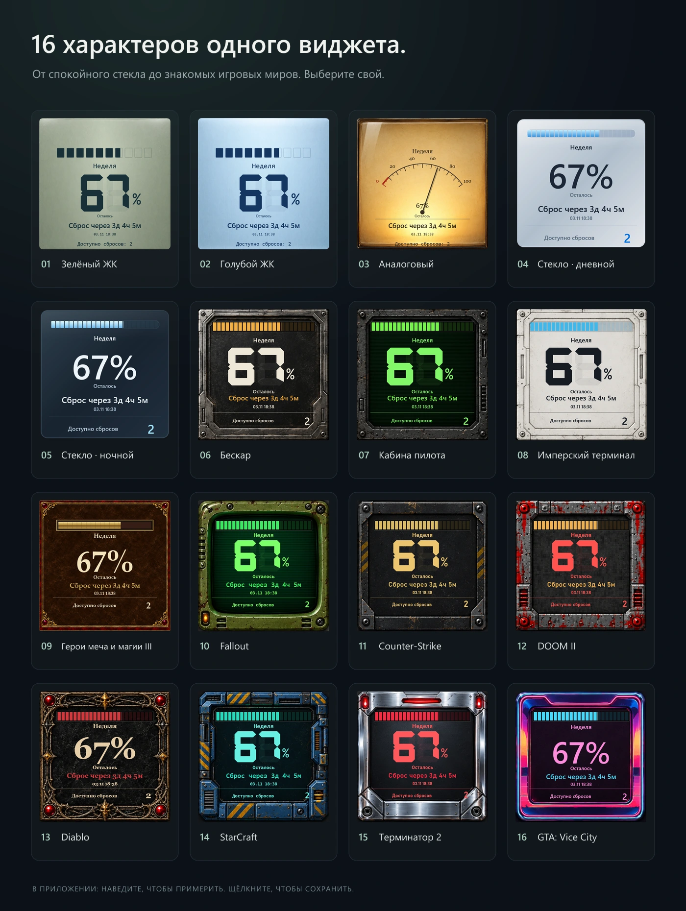

<div align="center">

# CodexMeter

**Лимиты Codex — на рабочем столе и в трее / строке меню.**  
Проценты, время до сброса и доступные сбросы. Одним взглядом.

[**↓ Скачать для Windows**](https://github.com/AlexDM777/codex-meter/releases/latest) &nbsp; · &nbsp; [**↓ Скачать для Mac**](https://github.com/AlexDM777/codex-meter/releases/download/v4.0.0/CodexMeter-4.0-macOS-universal.dmg) &nbsp; · &nbsp; [Все скины](#свой-характер) &nbsp; · &nbsp; [Как установить](#три-шага-до-первого-запуска)

Windows 10/11 · macOS 13+ · 16 скинов · 8 языков

</div>



| Главное — сразу | Ваше оформление | Обновляется само |
| :--- | :--- | :--- |
| Остаток и отсчёт до сброса крупно. Подробности — при наведении на трей. | 16 скинов, живая примерка и собственные темы. От стекла до игровых миров. | Новые версии через GitHub. Настройки, вход и пользовательские скины сохраняются. |

## Столько места, сколько нужно

Небольшой индикатор для работы, полный экран параметров — по двойному щелчку. Размер можно менять колесом мыши от 100 до 1000 пикселей.



## Цифры меняются мягко

Плавная смена процентов и короткий перекат цифр отсчёта. Анимация работает только в момент изменения и учитывает системные настройки движения.

<p align="center">
  
</p>

## Свой характер

Спокойный дневной или ночной интерфейс, классический ЖК, аналоговый индикатор и темы по мотивам любимых игр и фильмов. В приложении наведите курсор на скин для примерки, щёлкните для сохранения. Можно включить новый скин при каждом запуске или [загрузить собственный](SkinGuide.md).



<sub>На всех изображениях — реальный интерфейс версии 4.0 с демонстрационными значениями. Смена минут в ролике ускорена для показа эффекта.</sub>

## Не нашли свой скин? Создайте его с Codex

**Можно добавить собственную тему — менять код приложения не нужно.** Опишите своему Codex желаемый стиль: например, «тёмное дерево и латунь», «космический терминал» или «спокойный светлый интерфейс». Готовая MD-инструкция объяснит ему формат скина и расположение элементов.

### 1. Возьмите MD-инструкцию

[**Открыть SkinGuide.md для своего Codex →**](SkinGuide.md) · [Скачать MD-файл](https://raw.githubusercontent.com/AlexDM777/codex-meter/main/SkinGuide.md)

Её также можно скопировать прямо из приложения: **ПКМ → Настройки → Пользовательские скины → Скопировать MD-инструкцию**.

### 2. Создайте тему

Прикрепите `SkinGuide.md` к чату со своим Codex или вставьте скопированный текст и добавьте пожелания. Например:

> Создай скин для CodexMeter по приложенной MD-инструкции. Хочу тёмный деревянный корпус, тонкую латунную рамку и тёплые светлые цифры. Подготовь готовые файлы `skin.json` и `background.webp` в одной папке.

Фон — только оформление. Цифры, время и прогресс-бары приложение добавляет само, поэтому они продолжают показывать актуальные данные.

### 3. Загрузите скин в приложение

Оставьте `skin.json` и `background.webp` рядом в одной папке. Откройте **ПКМ → Настройки → Пользовательские скины → Загрузить скин…** и выберите **`skin.json`**.

Тема появится в общей галерее с собственным номером. Она применяется к виджету, маленькому индикатору и карточке трея; выбранная палитра используется и на значке трея. Пользовательские темы сохраняются при обновлениях приложения и участвуют в случайном выборе скина при запуске.

<details>
<summary>Установка вручную и совместимость</summary>

В меню **Пользовательские скины → Открыть папку скинов** можно открыть библиотеку и положить отдельную папку темы туда самостоятельно. Затем нажмите **Обновить список**. Путь библиотеки: `%LOCALAPPDATA%\CodexMeter\UserSkins`.

Прежние пакеты с `background.png` тоже поддерживаются; при импорте приложение сохраняет фон в WebP. Полная схема JSON и требования к изображению находятся в [SkinGuide.md](SkinGuide.md).

</details>

## Три шага до первого запуска

1. Установите официальный **Codex** и хотя бы один раз запустите его.
2. [Скачайте CodexMeter](https://github.com/AlexDM777/codex-meter/releases/latest): для Windows — **Setup.exe** или **Portable.zip**; для Mac — **macOS-universal.dmg** или **macOS-universal.zip**.
3. В настройках виджета выберите **«Войти в ChatGPT…»**.

Вход виджета хранится отдельно от основного Codex. Данные аккаунта не включаются в дистрибутив. Windows-версии нужны Windows 10/11 x64 и .NET Framework 4.8. Mac-версии — macOS 13 или новее; один Universal-пакет поддерживает Apple Silicon и Intel. Встроенная копия Codex не поставляется.

## Версия для Mac

[**Скачать DMG для macOS →**](https://github.com/AlexDM777/codex-meter/releases/download/v4.0.0/CodexMeter-4.0-macOS-universal.dmg) · [ZIP с приложением](https://github.com/AlexDM777/codex-meter/releases/download/v4.0.0/CodexMeter-macOS-universal.zip) · [Полная инструкция](macos/MACOS.md)

Откройте DMG и перенесите **CodexMeter.app** в **Applications («Программы»)**. После запуска проценты появятся в строке меню macOS. Наведение открывает карточку лимитов, ПКМ — меню, а в настройках можно войти в ChatGPT и выбрать скин. Если Codex не обнаружен, укажите его через «Путь к Codex…».

Mac-приложение использует AppKit и системный WebKit — встроенного браузера и отдельной копии Codex в пакете нет. Сохранены 16 скинов, маленькие индикаторы, собственные темы, языки, снимок виджета и обновления. Настройки и пользовательские темы хранятся в `~/Library/Application Support/CodexMeter`.

**Это первый Mac-выпуск:** обе архитектуры собраны и проверены на macOS-серверах GitHub, все 16 скинов отрисованы в WebKit. Авторизацию и живые лимиты на личном Mac пока не проверяли. Сборка имеет ad-hoc-подпись для целостности, но **не имеет Developer ID и нотариализации Apple**; macOS может ограничить первый запуск загруженного приложения. Не отключайте Gatekeeper. Ограничение подписи и самостоятельная сборка описаны в [инструкции для Mac](macos/MACOS.md).

<sub>Скриншоты в витрине выше показывают Windows-версию. macOS-версия использует ту же библиотеку скинов с отдельной оболочкой.</sub>

## Удобно каждый день

- **ПКМ** — скины, размер, прозрачность, снимок в буфер, поверх окон и настройки.
- **Колесо мыши** — изменить размер. **Двойной щелчок** — раскрыть виджет и вернуть прежний размер.
- **Трей** — остаток прямо на значке и подробная карточка при наведении.
- **Русский, English, Deutsch, Italiano, Español, Srpski, Français, Português.**
- **Автозапуск**, случайные скины, выбор лимита для маленького индикатора.

<details>
<summary><strong>Как работают обновления</strong></summary>

Приложение проверяет стабильные релизы этого репозитория через 15 секунд после запуска и затем каждые шесть часов. При наличии новой версии в карточке трея появляется уведомление и кнопка обновления. В настройках отдельно доступны обновление программы и обновление показателей.

Автообновление включено по умолчанию и отключается галочкой. Проверка SHA-256, резервная копия и откат защищают установку; после замены файлов программа запускается снова. Настройки, вход и пользовательские скины сохраняются. Если папка требует прав администратора, Windows покажет обычный запрос.

Запросы обновлений идут только к GitHub Releases; личные данные Codex и токены не отправляются. Для выпуска новой версии есть [RELEASING.md](RELEASING.md).

</details>

<details>
<summary><strong>Для разработчиков: сборка и проверки</strong></summary>

## Сборка

```powershell
powershell -ExecutionPolicy Bypass -File .\source\build.ps1
powershell -ExecutionPolicy Bypass -File .\release.ps1
```

Используется компилятор .NET Framework из Windows. Первая команда создаёт приложение и помощник обновления, вторая — ZIP, установщик, пакет обновления и SHA256SUMS в `dist`.

```powershell
.\CodexMeter.exe --self-test
.\CodexMeter.exe --custom-test
.\CodexMeter.exe --update-test
.\CodexMeter.exe --ui-test .\test-screen.png --data-dir .\test-profile
```

Последняя проверка запускает изолированный тестовый профиль; для подключения CLI нужен установленный Codex. Боевые настройки не используются.

</details>

## Ресурсы

Стили вдохновлены знакомыми игровыми и кинематографическими интерфейсами; приложение не связано с их правообладателями. Сторонние библиотеки и их условия перечислены в [ThirdParty.txt](ThirdParty.txt). Код публичен; отдельная лицензия проекта пока не выбрана.
